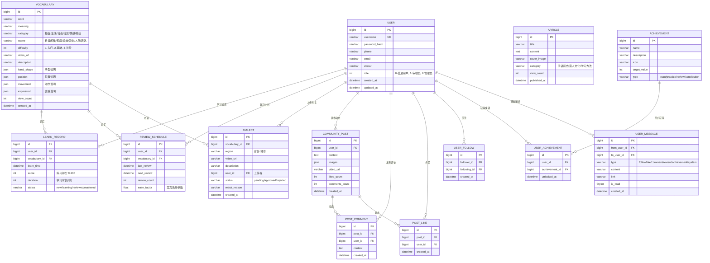
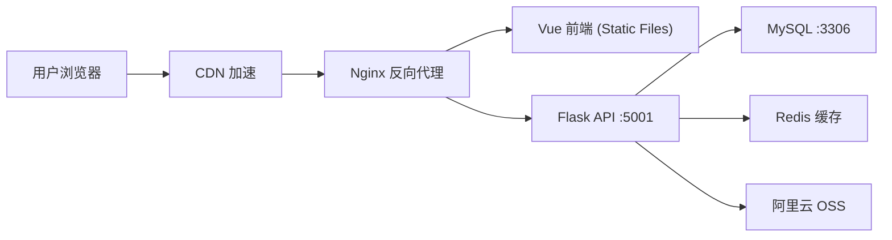

# 掌言手语平台 — 全栈开发设计文档

## 一、项目概述

### 1.1 项目定位

面向手语学习者的综合性 Web 平台，集手语词汇学习、AI 互动问答、AI 动作练习、数字人演示、艾宾浩斯复习、方言采集、社区交流于一体。

### 1.2 技术栈锁定

| 层级 | 技术选型 |
| --- | --- |
| 前端框架 | Vue 3 + Vite 5 |
| UI 组件库 | Element Plus 2.6 |
| 状态管理 | Pinia 2.1 |
| 路由 | Vue Router 4 |
| HTTP 客户端 | Axios 1.6 |
| 3D 渲染 | Three.js 0.162 |
| 图表 | ECharts 5.5 |
| 后端框架 | Flask 3.x (Python) |
| 数据库 | MySQL 8.x |
| 用户认证 | JWT (用户名/密码登录) |
| AI 助手 | GLM-5 API (智谱 AI) |
| 文件存储 | 本地磁盘 (开发) / OSS (生产) |

### 1.3 数据流向架构图

```
┌─────────────────────────────────────────────────────────────────┐
│                        Vue 3 前端                              │
│  ┌─────────┐  ┌──────────┐  ┌────────┐  ┌─────────────────┐   │
│  │   UI    │──│  Store   │──│ Router │──│  Axios API 调用 │   │
│  │ Element │  │  Pinia   │  │ 路由   │  │  /api/v1/*      │   │
│  │  Plus   │  │ 状态管理  │  │        │  │                 │   │
│  └─────────┘  └──────────┘  └────────┘  └────────┬────────┘   │
│       │                                          │             │
│       │ Three.js                                 │             │
│       ↓                                          ↓             │
│  ┌─────────┐                            ┌─────────────────┐   │
│  │ 3D 数字人 │                            │   Flask 后端    │   │
│  │ GLTF 模型 │                            │   :5001         │   │
│  └─────────┘                            └────────┬────────┘   │
│       │                                          │             │
│       │ MediaDevices                             │ PyTorch      │
│       ↓                                          ↓             │
│  ┌─────────┐                            ┌─────────────────┐   │
│  │ 摄像头采集 │                            │ CNN-LSTM 模型   │   │
│  │ (3秒视频) │                            │ 推理预测        │   │
│  └─────────┘                            └────────┬────────┘   │
│                                                  │             │
│                                                  │ MediaPipe   │
│                                                  ↓             │
│                                           ┌─────────────────┐ │
│                                           │ 84维关键点特征    │ │
│                                           │ 提取            │ │
│                                           └─────────────────┘ │
└─────────────────────────────────────────────────────────────────┘
```

### 1.4 前端页面清单

| 路由 | 页面名称 | 功能概述 |
| --- | --- | --- |
| `/` | 首页 | Banner轮播、每日一词、精选词条、手语科普入口 |
| `/login` | 登录页 | 用户名/密码登录 |
| `/register` | 注册页 | 用户注册 |
| `/dictionary` | 手语词典 | 词汇列表、多维筛选、视图切换 |
| `/dictionary/:id` | 词汇详情 | 视频播放、动作分解、收藏/生词/笔记 |
| `/practice` | 手语练习 | AI摄像头识别、置信度反馈 |
| `/avatar` | 数字人演示 | 3D模型播放、骨骼动画、相机控制 |
| `/tasks` | 学习任务 | 艾宾浩斯复习、每日打卡、学习统计 |
| `/assessment` | 学习测评 | 选择题、视频题、倒计时评分 |
| `/upload` | 上传方言 | 词条选择、视频上传、地区选择 |
| `/audit` | 审核状态 | 审核列表、审核通过/驳回 |
| `/community` | 社区动态 | 动态列表、发布、点赞评论 |
| `/science` | 手语科普 | 每日一句、科普文章、知识卡片 |
| `/data` | 学习数据中心 | 热力图、收藏/生词/笔记管理 |
| `/achievements` | 成就勋章 | 成就列表、积分商城 |
| `/profile` | 个人主页 | 用户信息、学习数据 |
| `/messages` | 消息中心 | 通知列表、消息详情 |
| `/settings` | 系统设置 | 悬浮球开关、播放设置 |

---

## 二、数据库设计

### 2.1 ER 图



### 2.2 核心表结构 SQL

```sql
-- 用户表
CREATE TABLE user (
    id BIGINT PRIMARY KEY AUTO_INCREMENT,
    username VARCHAR(50) UNIQUE NOT NULL,
    password_hash VARCHAR(255) NOT NULL,
    phone VARCHAR(20),
    email VARCHAR(100),
    avatar VARCHAR(500),
    exp INT DEFAULT 0 COMMENT '经验值',
    points INT DEFAULT 0 COMMENT '积分',
    level INT DEFAULT 1 COMMENT '等级',
    role TINYINT DEFAULT 0 COMMENT '0-普通用户, 1-审核员, 2-管理员',
    created_at TIMESTAMP DEFAULT CURRENT_TIMESTAMP,
    updated_at TIMESTAMP DEFAULT CURRENT_TIMESTAMP ON UPDATE CURRENT_TIMESTAMP,
    INDEX idx_username (username),
    INDEX idx_phone (phone)
);

-- 词汇表
CREATE TABLE vocabulary (
    id BIGINT PRIMARY KEY AUTO_INCREMENT,
    word VARCHAR(100) NOT NULL,
    meaning TEXT,
    category VARCHAR(50) COMMENT '基础/生活/社会/社交/情感/科技',
    scene VARCHAR(50) COMMENT '日常问候/家庭/饮食/职业/人际/表达',
    difficulty TINYINT DEFAULT 1 COMMENT '1-入门, 2-基础, 3-进阶',
    video_url VARCHAR(500),
    description TEXT,
    hand_shape JSON COMMENT '{"描述": "", "要点": []}',
    position JSON COMMENT '{"描述": "", "要点": []}',
    movement JSON COMMENT '{"描述": "", "要点": []}',
    expression JSON COMMENT '{"描述": "", "要���": []}',
    view_count INT DEFAULT 0,
    created_at TIMESTAMP DEFAULT CURRENT_TIMESTAMP,
    INDEX idx_category (category),
    INDEX idx_difficulty (difficulty)
);

-- 学习记录表
CREATE TABLE learn_record (
    id BIGINT PRIMARY KEY AUTO_INCREMENT,
    user_id BIGINT NOT NULL,
    vocabulary_id BIGINT NOT NULL,
    learn_time TIMESTAMP DEFAULT CURRENT_TIMESTAMP,
    score INT DEFAULT 0 COMMENT '0-100',
    duration INT DEFAULT 0 COMMENT '学习时长秒',
    status VARCHAR(20) DEFAULT 'new' COMMENT 'new/learning/reviewed/mastered',
    FOREIGN KEY (user_id) REFERENCES user(id) ON DELETE CASCADE,
    FOREIGN KEY (vocabulary_id) REFERENCES vocabulary(id) ON DELETE CASCADE,
    INDEX idx_user_vocab (user_id, vocabulary_id)
);

-- 艾宾浩斯复习表
CREATE TABLE review_schedule (
    id BIGINT PRIMARY KEY AUTO_INCREMENT,
    user_id BIGINT NOT NULL,
    vocabulary_id BIGINT NOT NULL,
    last_review TIMESTAMP,
    next_review TIMESTAMP,
    review_count INT DEFAULT 0,
    ease_factor FLOAT DEFAULT 2.5,
    FOREIGN KEY (user_id) REFERENCES user(id) ON DELETE CASCADE,
    FOREIGN KEY (vocabulary_id) REFERENCES vocabulary(id) ON DELETE CASCADE,
    UNIQUE KEY uk_user_vocab (user_id, vocabulary_id)
);

-- 方言手语表
CREATE TABLE dialect (
    id BIGINT PRIMARY KEY AUTO_INCREMENT,
    vocabulary_id BIGINT NOT NULL,
    region VARCHAR(100) NOT NULL COMMENT '省份-城市',
    video_url VARCHAR(500),
    description TEXT,
    user_id BIGINT NOT NULL,
    status VARCHAR(20) DEFAULT 'pending' COMMENT 'pending/approved/rejected',
    reject_reason VARCHAR(500),
    created_at TIMESTAMP DEFAULT CURRENT_TIMESTAMP,
    FOREIGN KEY (vocabulary_id) REFERENCES vocabulary(id) ON DELETE CASCADE,
    FOREIGN KEY (user_id) REFERENCES user(id) ON DELETE CASCADE,
    INDEX idx_status (status),
    INDEX idx_region (region)
);

-- 社区帖子表
CREATE TABLE community_post (
    id BIGINT PRIMARY KEY AUTO_INCREMENT,
    user_id BIGINT NOT NULL,
    content TEXT,
    images JSON,
    video_url VARCHAR(500),
    likes_count INT DEFAULT 0,
    comments_count INT DEFAULT 0,
    created_at TIMESTAMP DEFAULT CURRENT_TIMESTAMP,
    FOREIGN KEY (user_id) REFERENCES user(id) ON DELETE CASCADE,
    INDEX idx_created (created_at)
);

-- 帖子评论表
CREATE TABLE post_comment (
    id BIGINT PRIMARY KEY AUTO_INCREMENT,
    post_id BIGINT NOT NULL,
    user_id BIGINT NOT NULL,
    content TEXT,
    created_at TIMESTAMP DEFAULT CURRENT_TIMESTAMP,
    FOREIGN KEY (post_id) REFERENCES community_post(id) ON DELETE CASCADE,
    FOREIGN KEY (user_id) REFERENCES user(id) ON DELETE CASCADE
);

-- 帖子点赞表
CREATE TABLE post_like (
    id BIGINT PRIMARY KEY AUTO_INCREMENT,
    post_id BIGINT NOT NULL,
    user_id BIGINT NOT NULL,
    created_at TIMESTAMP DEFAULT CURRENT_TIMESTAMP,
    FOREIGN KEY (post_id) REFERENCES community_post(id) ON DELETE CASCADE,
    FOREIGN KEY (user_id) REFERENCES user(id) ON DELETE CASCADE,
    UNIQUE KEY uk_post_user (post_id, user_id)
);

-- 用户关注表
CREATE TABLE user_follow (
    id BIGINT PRIMARY KEY AUTO_INCREMENT,
    follower_id BIGINT NOT NULL,
    following_id BIGINT NOT NULL,
    created_at TIMESTAMP DEFAULT CURRENT_TIMESTAMP,
    FOREIGN KEY (follower_id) REFERENCES user(id) ON DELETE CASCADE,
    FOREIGN KEY (following_id) REFERENCES user(id) ON DELETE CASCADE,
    UNIQUE KEY uk_follow (follower_id, following_id)
);

-- 科普文章表
CREATE TABLE article (
    id BIGINT PRIMARY KEY AUTO_INCREMENT,
    title VARCHAR(200) NOT NULL,
    content TEXT,
    cover_image VARCHAR(500),
    category VARCHAR(50) COMMENT '手语历史/聋人文化/学习方法',
    view_count INT DEFAULT 0,
    published_at TIMESTAMP DEFAULT CURRENT_TIMESTAMP,
    INDEX idx_category (category)
);

-- 成就表
CREATE TABLE achievement (
    id BIGINT PRIMARY KEY AUTO_INCREMENT,
    name VARCHAR(100) NOT NULL,
    description TEXT,
    icon VARCHAR(200),
    target_value INT,
    type VARCHAR(20) COMMENT 'learn/practice/review/contribution'
);

-- 用户成就表
CREATE TABLE user_achievement (
    id BIGINT PRIMARY KEY AUTO_INCREMENT,
    user_id BIGINT NOT NULL,
    achievement_id BIGINT NOT NULL,
    unlocked_at TIMESTAMP DEFAULT CURRENT_TIMESTAMP,
    FOREIGN KEY (user_id) REFERENCES user(id) ON DELETE CASCADE,
    FOREIGN KEY (achievement_id) REFERENCES achievement(id) ON DELETE CASCADE,
    UNIQUE KEY uk_user_ach (user_id, achievement_id)
);

-- 用户消息表
CREATE TABLE user_message (
    id BIGINT PRIMARY KEY AUTO_INCREMENT,
    from_user_id BIGINT,
    to_user_id BIGINT NOT NULL,
    type VARCHAR(20) COMMENT 'follow/like/comment/review/achievement/system',
    content VARCHAR(500),
    link VARCHAR(200),
    is_read TINYINT DEFAULT 0,
    created_at TIMESTAMP DEFAULT CURRENT_TIMESTAMP,
    FOREIGN KEY (to_user_id) REFERENCES user(id) ON DELETE CASCADE,
    INDEX idx_to_read (to_user_id, is_read)
);
```

### 2.3 补充表结构

```sql
-- 学习时长记录表
CREATE TABLE study_time_record (
    id BIGINT PRIMARY KEY AUTO_INCREMENT,
    user_id BIGINT NOT NULL,
    date DATE NOT NULL COMMENT '学习日期',
    minutes INT DEFAULT 0 COMMENT '学习分钟数',
    created_at TIMESTAMP DEFAULT CURRENT_TIMESTAMP,
    updated_at TIMESTAMP DEFAULT CURRENT_TIMESTAMP ON UPDATE CURRENT_TIMESTAMP,
    FOREIGN KEY (user_id) REFERENCES user(id) ON DELETE CASCADE,
    UNIQUE KEY uk_user_date (user_id, date)
);

-- 每日任务记录表
CREATE TABLE daily_task_record (
    id BIGINT PRIMARY KEY AUTO_INCREMENT,
    user_id BIGINT NOT NULL,
    date DATE NOT NULL COMMENT '任务日期',
    task_type VARCHAR(20) NOT NULL COMMENT 'learn/review/practice/share',
    completed TINYINT DEFAULT 0,
    created_at TIMESTAMP DEFAULT CURRENT_TIMESTAMP,
    FOREIGN KEY (user_id) REFERENCES user(id) ON DELETE CASCADE,
    UNIQUE KEY uk_user_date_task (user_id, date, task_type)
);

-- 每日签到表
CREATE TABLE checkin_record (
    id BIGINT PRIMARY KEY AUTO_INCREMENT,
    user_id BIGINT NOT NULL,
    date DATE NOT NULL,
    created_at TIMESTAMP DEFAULT CURRENT_TIMESTAMP,
    FOREIGN KEY (user_id) REFERENCES user(id) ON DELETE CASCADE,
    UNIQUE KEY uk_user_date (user_id, date)
);

-- 测评试卷表
CREATE TABLE test_paper (
    id BIGINT PRIMARY KEY AUTO_INCREMENT,
    name VARCHAR(100) NOT NULL COMMENT '试卷名称',
    level VARCHAR(20) COMMENT '等级标识: 基础/进阶/高级',
    description TEXT COMMENT '试卷描述',
    question_count INT DEFAULT 0 COMMENT '题目数量',
    total_score INT DEFAULT 100 COMMENT '满分',
    time_limit INT DEFAULT 30 COMMENT '时间限制(分钟)',
    prerequisite VARCHAR(50) COMMENT '前置条件: 如 level>=2',
    sort_order INT DEFAULT 0,
    created_at TIMESTAMP DEFAULT CURRENT_TIMESTAMP
);

-- 测评题目表
CREATE TABLE test_question (
    id BIGINT PRIMARY KEY AUTO_INCREMENT,
    paper_id BIGINT NOT NULL,
    vocabulary_id BIGINT COMMENT '关联词汇',
    type VARCHAR(20) NOT NULL COMMENT 'choice/video',
    content TEXT NOT NULL COMMENT '题目内容',
    options JSON COMMENT '选项 ["A", "B", "C", "D"]',
    correct_answer VARCHAR(10) COMMENT '正确答案',
    video_url VARCHAR(500) COMMENT '视频题视频',
    explanation TEXT COMMENT '解析',
    score INT DEFAULT 10 COMMENT '分值',
    sort_order INT DEFAULT 0,
    FOREIGN KEY (paper_id) REFERENCES test_paper(id) ON DELETE CASCADE,
    FOREIGN KEY (vocabulary_id) REFERENCES vocabulary(id) ON DELETE SET NULL
);

-- 测评成绩记录表
CREATE TABLE test_record (
    id BIGINT PRIMARY KEY AUTO_INCREMENT,
    user_id BIGINT NOT NULL,
    paper_id BIGINT NOT NULL,
    score INT NOT NULL COMMENT '得分',
    duration INT COMMENT '用时(秒)',
    answers JSON COMMENT '用户答案 {question_id: answer}',
    wrong_questions JSON COMMENT '错题列表',
    completed_at TIMESTAMP DEFAULT CURRENT_TIMESTAMP,
    FOREIGN KEY (user_id) REFERENCES user(id) ON DELETE CASCADE,
    FOREIGN KEY (paper_id) REFERENCES test_paper(id) ON DELETE CASCADE,
    INDEX idx_user_paper (user_id, paper_id)
);

-- 每日一句表
CREATE TABLE daily_sentence (
    id BIGINT PRIMARY KEY AUTO_INCREMENT,
    text VARCHAR(200) NOT NULL COMMENT '句子',
    translation VARCHAR(200) COMMENT '翻译',
    category VARCHAR(50) COMMENT '分类',
    sort_order INT DEFAULT 0,
    created_at TIMESTAMP DEFAULT CURRENT_TIMESTAMP
);

-- 科普视频表
CREATE TABLE science_video (
    id BIGINT PRIMARY KEY AUTO_INCREMENT,
    title VARCHAR(200) NOT NULL,
    description TEXT,
    cover_image VARCHAR(500),
    video_url VARCHAR(500),
    duration VARCHAR(20) COMMENT '时长如 "3:25"',
    category VARCHAR(50) COMMENT '分类',
    view_count INT DEFAULT 0,
    created_at TIMESTAMP DEFAULT CURRENT_TIMESTAMP
);

-- 手语知识卡片表
CREATE TABLE knowledge_card (
    id BIGINT PRIMARY KEY AUTO_INCREMENT,
    title VARCHAR(100) NOT NULL,
    icon VARCHAR(50) COMMENT '图标 emoji',
    description TEXT,
    content TEXT COMMENT '详细内容',
    category VARCHAR(50) COMMENT '分类',
    sort_order INT DEFAULT 0,
    created_at TIMESTAMP DEFAULT CURRENT_TIMESTAMP
);

-- 用户等级配置表
CREATE TABLE level_config (
    level INT PRIMARY KEY,
    name VARCHAR(50) COMMENT '等级名称',
    min_exp INT NOT NULL COMMENT '所需最小经验',
    icon VARCHAR(100) COMMENT '等级图标'
);

-- 积分规则表
CREATE TABLE points_rule (
    id INT PRIMARY KEY AUTO_INCREMENT,
    action VARCHAR(50) NOT NULL COMMENT '动作类型',
    points INT NOT NULL COMMENT '积分数量',
    description VARCHAR(200),
    UNIQUE KEY uk_action (action)
);

-- 积分记录表
CREATE TABLE points_record (
    id BIGINT PRIMARY KEY AUTO_INCREMENT,
    user_id BIGINT NOT NULL,
    action VARCHAR(50) NOT NULL,
    points INT NOT NULL COMMENT '正数增加,负数消耗',
    balance INT NOT NULL COMMENT '变动后余额',
    description VARCHAR(200),
    created_at TIMESTAMP DEFAULT CURRENT_TIMESTAMP,
    FOREIGN KEY (user_id) REFERENCES user(id) ON DELETE CASCADE,
    INDEX idx_user_created (user_id, created_at)
);

-- 积分商城商品表
CREATE TABLE shop_product (
    id BIGINT PRIMARY KEY AUTO_INCREMENT,
    name VARCHAR(100) NOT NULL,
    description TEXT,
    icon VARCHAR(100) COMMENT '商品图标',
    price INT NOT NULL COMMENT '所需积分',
    stock INT DEFAULT -1 COMMENT '-1表示无限',
    sort_order INT DEFAULT 0,
    is_active TINYINT DEFAULT 1,
    created_at TIMESTAMP DEFAULT CURRENT_TIMESTAMP
);

-- 积分兑换记录表
CREATE TABLE exchange_record (
    id BIGINT PRIMARY KEY AUTO_INCREMENT,
    user_id BIGINT NOT NULL,
    product_id BIGINT NOT NULL,
    points_spent INT NOT NULL,
    status VARCHAR(20) DEFAULT 'pending' COMMENT 'pending/completed',
    created_at TIMESTAMP DEFAULT CURRENT_TIMESTAMP,
    FOREIGN KEY (user_id) REFERENCES user(id) ON DELETE CASCADE,
    FOREIGN KEY (product_id) REFERENCES shop_product(id) ON DELETE CASCADE
);

-- AI 聊天记录表
CREATE TABLE ai_chat_history (
    id BIGINT PRIMARY KEY AUTO_INCREMENT,
    user_id BIGINT NOT NULL,
    session_id VARCHAR(50) COMMENT '会话ID',
    role VARCHAR(10) NOT NULL COMMENT 'user/assistant',
    content TEXT NOT NULL,
    created_at TIMESTAMP DEFAULT CURRENT_TIMESTAMP,
    FOREIGN KEY (user_id) REFERENCES user(id) ON DELETE CASCADE,
    INDEX idx_user_session (user_id, session_id)
);

-- 用户设置表
CREATE TABLE user_settings (
    id BIGINT PRIMARY KEY AUTO_INCREMENT,
    user_id BIGINT UNIQUE NOT NULL,
    floating_ball_enabled TINYINT DEFAULT 1 COMMENT '悬浮球开关',
    notifications_enabled TINYINT DEFAULT 1 COMMENT '消息通知开关',
    default_playback_speed DECIMAL(3,2) DEFAULT 1.00 COMMENT '默认播放速度',
    auto_play TINYINT DEFAULT 0 COMMENT '自动播放开关',
    download_quality VARCHAR(10) DEFAULT 'high' COMMENT '下载质量: low/medium/high',
    updated_at TIMESTAMP DEFAULT CURRENT_TIMESTAMP ON UPDATE CURRENT_TIMESTAMP,
    FOREIGN KEY (user_id) REFERENCES user(id) ON DELETE CASCADE
);

-- 用户收藏表
CREATE TABLE user_favorite (
    id BIGINT PRIMARY KEY AUTO_INCREMENT,
    user_id BIGINT NOT NULL,
    vocabulary_id BIGINT NOT NULL,
    created_at TIMESTAMP DEFAULT CURRENT_TIMESTAMP,
    FOREIGN KEY (user_id) REFERENCES user(id) ON DELETE CASCADE,
    FOREIGN KEY (vocabulary_id) REFERENCES vocabulary(id) ON DELETE CASCADE,
    UNIQUE KEY uk_user_vocab (user_id, vocabulary_id)
);

-- 用户生词表
CREATE TABLE user_new_word (
    id BIGINT PRIMARY KEY AUTO_INCREMENT,
    user_id BIGINT NOT NULL,
    vocabulary_id BIGINT NOT NULL,
    created_at TIMESTAMP DEFAULT CURRENT_TIMESTAMP,
    FOREIGN KEY (user_id) REFERENCES user(id) ON DELETE CASCADE,
    FOREIGN KEY (vocabulary_id) REFERENCES vocabulary(id) ON DELETE CASCADE,
    UNIQUE KEY uk_user_vocab (user_id, vocabulary_id)
);

-- 用户笔记表
CREATE TABLE user_note (
    id BIGINT PRIMARY KEY AUTO_INCREMENT,
    user_id BIGINT NOT NULL,
    vocabulary_id BIGINT NOT NULL,
    content TEXT NOT NULL,
    created_at TIMESTAMP DEFAULT CURRENT_TIMESTAMP,
    updated_at TIMESTAMP DEFAULT CURRENT_TIMESTAMP ON UPDATE CURRENT_TIMESTAMP,
    FOREIGN KEY (user_id) REFERENCES user(id) ON DELETE CASCADE,
    FOREIGN KEY (vocabulary_id) REFERENCES vocabulary(id) ON DELETE CASCADE,
    INDEX idx_user_vocab (user_id, vocabulary_id)
);
```

### 2.4 全部数据表清单

共 **32 张核心数据表**：

| 序号 | 表名 | 用途 | 来源页面 |
| --- | --- | --- | --- |
| 1 | user | 用户信息 | 全局 |
| 2 | vocabulary | 词汇表 | 词典/练习/复习 |
| 3 | learn_record | 学习记录 | 练习页 |
| 4 | review_schedule | 艾宾浩斯复习 | 任务页 |
| 5 | dialect | 方言手语 | 上传/审核 |
| 6 | community_post | 社区帖子 | 社区页 |
| 7 | post_comment | 帖子评论 | 社区页 |
| 8 | post_like | 帖子点赞 | 社区页 |
| 9 | user_follow | 用户关注 | 社区/个人页 |
| 10 | article | 科普文章 | 科普页 |
| 11 | achievement | 成就定义 | 成就页 |
| 12 | user_achievement | 用户成就 | 成就页 |
| 13 | user_message | 消息通知 | 消息页 |
| 14 | study_time_record | 学习时长 | 数据中心/任务 |
| 15 | daily_task_record | 每日任务 | 任务页 |
| 16 | checkin_record | 签到记录 | 任务/成就 |
| 17 | test_paper | 测评试卷 | 测评页 |
| 18 | test_question | 测评题目 | 测评页 |
| 19 | test_record | 测评成绩 | 测评/个人页 |
| 20 | daily_sentence | 每日一句 | 科普/首页 |
| 21 | science_video | 科普视频 | 科普页 |
| 22 | knowledge_card | 知识卡片 | 科普页 |
| 23 | level_config | 等级配置 | 成就/个人页 |
| 24 | points_rule | 积分规则 | 全局 |
| 25 | points_record | 积分记录 | 全局 |
| 26 | shop_product | 积分商品 | 成就页 |
| 27 | exchange_record | 兑换记录 | 成就页 |
| 28 | ai_chat_history | AI聊天记录 | AI助手 |
| 29 | user_settings | 用户设置 | 设置页 |
| 30 | user_favorite | 收藏 | 个人页 |
| 31 | user_new_word | 生词 | 个人页 |
| 32 | user_note | 笔记 | 个人页 |

### 2.5 等级与积分系统数据

**等级配置初始数据 (level_config)**：

| Level | Name | Min Exp |
| --- | --- | --- |
| 1 | 入门 | 0 |
| 2 | 初学 | 100 |
| 3 | 进阶 | 300 |
| 4 | 熟练 | 600 |
| 5 | 精通 | 1000 |
| 6 | 专家 | 2000 |
| 7 | 大师 | 5000 |
| 8 | 宗师 | 10000 |

**积分规则初始数据 (points_rule)**：

| Action | Points | Description |
| --- | --- | --- |
| daily_login | +5 | 每日登录 |
| daily_checkin | +2 | 每日签到 |
| learn_word | +2 | 学习一个词汇 |
| practice | +1 | 完成一次练习 |
| review | +1 | 完成一次复习 |
| post | +5 | 发布动态 |
| dialect_approved | +10 | 方言审核通过 |
| test_pass | +5 | 通过测评 |
| exchange_product | -X | 兑换商品消耗 |

---

## 三、API 接口设计

### 3.1 API 规范

| 项目 | 说明 |
| --- | --- |
| Base URL | `/api/v1` |
| 认证方式 | Bearer Token (JWT) |
| 响应格式 | `{ "code": 200, "message": "success", "data": {} }` |
| 错误码 | 401-未认证, 403-禁止, 404-不存在, 500-服务器错误 |

### 3.2 认证接口

| 接口 | 方法 | 说明 |
| --- | --- | --- |
| `/api/v1/auth/register` | POST | 用户注册 |
| `/api/v1/auth/login` | POST | 用户登录 |
| `/api/v1/auth/logout` | POST | 退出登录 |
| `/api/v1/auth/refresh` | POST | 刷新 Token |
| `/api/v1/auth/profile` | GET | 获取个人资料 |
| `/api/v1/auth/profile` | PUT | 更新个人资料 |

### 3.3 词汇接口

| 接口 | 方法 | 说明 |
| --- | --- | --- |
| `/api/v1/words` | GET | 获取词汇列表 (分页+筛选) |
| `/api/v1/words/:id` | GET | 获取词汇详情 |
| `/api/v1/words/:id/view` | POST | 增加浏览量 |
| `/api/v1/words/random` | GET | 获取随机词汇 (每日一词) |

### 3.4 练习与复习接口

| 接口 | 方法 | 说明 |
| --- | --- | --- |
| `/api/v1/practice/init-model` | POST | 初始化识别模型 |
| `/api/v1/practice/predict` | POST | 识别手语视频 |
| `/api/v1/review/today` | GET | 获取今日待复习 |
| `/api/v1/review/record` | POST | 记录复习结果 |
| `/api/v1/review/calculate` | GET | 计算下次复习时间 |

### 3.5 方言手语接口

| 接口 | 方法 | 说明 |
| --- | --- | --- |
| `/api/v1/dialects` | GET | 获取方言列表 |
| `/api/v1/dialects` | POST | 上传方言手语 |
| `/api/v1/dialects/:id` | GET | 获取方言详情 |
| `/api/v1/dialects/audit` | GET | 审核列表 (管理员) |
| `/api/v1/dialects/:id/audit` | PUT | 审核方言 (管理员) |
| `/api/v1/dialects/me` | GET | 我的上传记录 |

### 3.6 社区接口

| 接口 | 方法 | 说明 |
| --- | --- | --- |
| `/api/v1/posts` | GET | 获取动态列表 |
| `/api/v1/posts` | POST | 发布动态 |
| `/api/v1/posts/:id` | GET | 获取动态详情 |
| `/api/v1/posts/:id/comment` | POST | 评论动态 |
| `/api/v1/posts/:id/like` | POST | 点赞动态 |
| `/api/v1/posts/:id/like` | DELETE | 取消点赞 |
| `/api/v1/follow/:userId` | POST | 关注用户 |
| `/api/v1/follow/:userId` | DELETE | 取消关注 |

### 3.7 科普文章接口

| 接口 | 方法 | 说明 |
| --- | --- | --- |
| `/api/v1/articles` | GET | 获取文章列表 |
| `/api/v1/articles/:id` | GET | 获取文章详情 |
| `/api/v1/articles/random-sentence` | GET | 获取每日一句 |

### 3.8 成就接口

| 接口 | 方法 | 说明 |
| --- | --- | --- |
| `/api/v1/achievements` | GET | 获取成就列表 |
| `/api/v1/achievements/me` | GET | 获取我的成就 |
| `/api/v1/achievements/check` | GET | 检查新成就 |

### 3.9 消息接口

| 接口 | 方法 | 说明 |
| --- | --- | --- |
| `/api/v1/messages` | GET | 获取消息列表 |
| `/api/v1/messages/unread-count` | GET | 获取未读数 |
| `/api/v1/messages/:id/read` | PUT | 标记已读 |

### 3.10 AI 助手接口

| 接口 | 方法 | 说明 |
| --- | --- | --- |
| `/api/v1/ai/chat` | POST | AI 对话 |

### 3.11 测评接口

| 接口 | 方法 | 说明 |
| --- | --- | --- |
| `/api/v1/assessment/papers` | GET | 获取试卷列表 |
| `/api/v1/assessment/papers/:id` | GET | 获取试卷详情 |
| `/api/v1/assessment/submit` | POST | 提交测评答案 |

### 3.12 学习数据中心接口

| 接口 | 方法 | 说明 |
| --- | --- | --- |
| `/api/v1/data/favorites` | GET | 获取收藏列表 |
| `/api/v1/data/newwords` | GET | 获取生词列表 |
| `/api/v1/data/notes` | GET/POST | 获取/添加笔记 |
| `/api/v1/data/study-time` | GET | 获取学习时长 |
| `/api/v1/data/heatmap` | GET | 获取学习热力图数据 |

### 3.13 积分商城接口

| 接口 | 方法 | 说明 |
| --- | --- | --- |
| `/api/v1/shop/products` | GET | 获取商品列表 |
| `/api/v1/shop/exchange` | POST | 兑换商品 |
| `/api/v1/shop/exchange/history` | GET | 兑换历史 |

### 3.14 用户设置接口

| 接口 | 方法 | 说明 |
| --- | --- | --- |
| `/api/v1/settings` | GET | 获取设置 |
| `/api/v1/settings` | PUT | 更新设置 |

---

## 四、功能模块详细设计

### 4.1 手语词典

**前端页面**: `/dictionary`, `/dictionary/:id`

**核心交互**:
1. 用户进入词典页 → 请求 `/api/v1/words` → 展示词汇卡片网格
2. 支持多维筛选：分类、场景、难度、关键词搜索
3. 点击词汇卡片 → 跳转到 `/dictionary/:id` → 请求详情 + 方言
4. 详情页支持：视频播放、动作分解、收藏、标记生词、添加笔记

**数据存储**:
```javascript
// Pinia store
useLearnStore: {
  favorites: Set<vocabulary_id>,    // localStorage → user_favorite
  newWords: Set<vocabulary_id>,     // localStorage → user_new_word
  notes: Map<vocabulary_id, Note>, // localStorage → user_note
  learnRecords: [],                // 同步到后端
}
```

### 4.2 AI 学习助手

**UI**: 全局悬浮球 (右下角)

**核心交互**:
1. 悬浮球始终可见，点击展开对话框
2. 对话框包含：输入框、发送按钮、历史记录列表
3. 发送消息 → 调用后端 `/api/v1/ai/chat` → 调用 GLM-5 API → 返回结果
4. 上下文关联：可追问手语动作细节

**AI 服务实现**:
```python
# 后端 /api/v1/ai/chat
{
    "messages": [
        {"role": "system", "content": "你是手语学习助手..."},
        {"role": "user", "content": "怎么学习手语？"}
    ]
}
```

### 4.3 手语练习 (AI 识别)

**前端页面**: `/practice`

**核心交互**:
1. 选择词条 → 请求 `/api/v1/words` 加载词汇列表
2. 点击"开始练习" → 申请摄像头权限 → 启动 MediaRecorder
3. 录制 3 秒 → 发送给后端 `/api/v1/practice/predict`
4. 后端处理：MediaPipe 特征提取 → CNN-LSTM 推理 → 返回结果
5. 前端展示：置信度、判定结果（正确/错误）、对比标准动作

**状态机**:
```
select → (选择词条) → ready → (点击开始) → recording → (3秒) → analyzing → result
```

### 4.4 数字人演示

**前端页面**: `/avatar`

**核心交互**:
1. 用户输入文字 → 查找是否有对应的预制动画
2. 找到则加载对应的 glb 模型播���
3. 3D 场景支持：旋转、缩放、背景切换
4. 播放控制：播放/暂停、重播、速度调节

**模型映射表** (已预制动画):
```javascript
modelMap = {
  '你好': 'niwo.glb',
  '谢谢': 'xiexie1.glb',
  '早上好': 'zaoshang.glb',
  // ... 更多映射
}
```

### 4.5 艾宾浩斯复习

**前端页面**: `/tasks`

**核心交互**:
1. 页面加载 → 请求 `/api/v1/review/today` 获取今日待复习词
2. 点击"开始复习" → 进入复习流程
3. 复习完成 → 调用 `/api/v1/review/record` 记录结果
4. 后端根据艾宾浩斯公式计算下次复习时间
5. 每日打卡任务：每日一学、复习巩固、练习打卡、分享互动

**艾宾浩斯公式**:
```python
# 后端 Python 实现
next_interval = last_interval * ease_factor
if correct:
    ease_factor = max(1.3, ease_factor + 0.1)
else:
    ease_factor = max(1.3, ease_factor - 0.2)
    next_interval = 1  # 重新开始
# 复习间隔: 1天 → 3天 → 7天 → 14天 → 30天 → ...
```

### 4.6 方言手语采集

**前端页面**: `/upload`, `/audit`

**核心交互**:
1. 选择标准词条 → 选择省份地区 → 上传视频
2. 提交 → 调用 `/api/v1/dialects` (POST)
3. 审核员登录 → 访问 `/audit` → 查看待审核列表
4. 审核通过/驳回 → 调用 `/api/v1/dialects/:id/audit`

**数据流**:
```
用户上传 → 状态: pending → 审核员审核
                                 ↓
                            通过 → video_url 公开 → 所有人可见
                            驳回 → reject_reason 记录 → 用户可见
```

### 4.7 社区动态

**前端页面**: `/community`

**核心交互**:
1. 动态列表 → 请求 `/api/v1/posts` (支持最新/最热/关注筛选)
2. 发布动态 → 调用 `/api/v1/posts` (POST) 支持文字+图片+视频
3. 点赞/评论/分享 → 调用对应接口
4. 关注用户 → 调用 `/api/v1/follow/:userId`

**实时性**: 轮询或 WebSocket (可选)

### 4.8 手语科普

**前端页面**: `/science`

**核心交互**:
1. 每日一词/每日一句 → 请求 `/api/v1/words/random` 和 `/api/v1/articles/random-sentence`
2. 文章列表 → 请求 `/api/v1/articles` (分页)
3. 点击文章 → 跳转详情页

### 4.9 成就系统

**前端页面**: `/achievements`

**核心交互**:
1. 获取成就列表 → 请求 `/api/v1/achievements`
2. 获取我的成就 → 请求 `/api/v1/achievements/me`
3. 检查新成就 → 请求 `/api/v1/achievements/check`

**触发时机**:
- 学习 X 个词汇
- 练习 X 次
- 复习 X 天连续
- 上传 X 个方言

### 4.10 学习数据中心

**前端页面**: `/data`

**核心交互**:
1. 读取 Pinia store 中的学习数据
2. ECharts 渲染：热力图、折线图、饼图
3. 展示：收藏/生词/笔记列表

---

## 五、文件上传设计

### 5.1 上传目录结构

```
uploads/
├── videos/           # 手语视频
│   ├── vocabulary/   # 词汇标准视频
│   └── dialect/     # 方言手语视频
├── posts/           # 社区帖子图片/视频
├── avatars/         # 用户头像
└── articles/        # 科普文章封面
```

### 5.2 上传接口

```javascript
POST /api/v1/upload
Content-Type: multipart/form-data

{
    file: File,
    type: 'vocabulary' | 'dialect' | 'post' | 'avatar' | 'article'
}

// 返回
{
    "code": 200,
    "data": {
        "url": "/uploads/vocabulary/xxx.mp4",
        "filename": "xxx.mp4"
    }
}
```

---

## 六、部署架构

### 6.1 开发环境

```
前端: http://localhost:5173 (Vite)
后端: http://localhost:5001 (Flask)
数据库: MySQL (localhost:3306)
```

### 6.2 生产环境



---

## 七、开发计划

### Phase 1: 后端基础搭建 (预计 2-3 天)

1. 初始化 Flask 项目结构
2. 配置 MySQL 数据库连接
3. 实现 JWT 认证系统
4. 实现用户管理 API

### Phase 2: 核心数据接口 (预计 3-4 天)

1. 实现词汇 CRUD API
2. 实现学习记录 API
3. 实现艾宾浩斯复习 API

### Phase 3: 前端重构 (预计 5-7 天)

1. 改造 API 层对接真实后端
2. 实现登录/注册流程
3. 重构词典页面
4. 重构练习页面

### Phase 4: 社区与采集 (预计 4-5 天)

1. 实现社区帖子 API
2. 实现方言上传 API
3. 实现审核流程 API

### Phase 5: 其他功能 (预计 3-4 天)

1. 实现科普文章 API
2. 实现成就系统 API
3. 实现消息通知 API

### Phase 6: 集成与测试 (预计 2-3 天)

1. 前后端联调
2. 功能测试
3. 部署文档

---

## 八、所需数据集清单

在开始 Phase 2 之前，请准备以下数据：

| 数据类型 | 格式要求 | 用途 |
| --- | --- | --- |
| 词汇表 | Excel/CSV: word, meaning, category, scene, difficulty | 初始化 vocabulary 表 |
| 词汇视频 | MP4, 每个词汇一个视频文件 | vocabulary.video_url |
| 动作分解说明 | JSON: {hand_shape, position, movement, expression} | 词汇详情页 |
| 科普文章 | Markdown/HTML 格式 | article 表 |
| 成就定义 | JSON: [{name, description, icon, target, type}] | achievement 表 |

---

## 九、注意事项

1. **JWT Token 有效期**: 建议 access_token 有效期 2 小时，refresh_token 有效期 7 天
2. **密码加密**: 使用 bcrypt 或 argon2 进行密码哈希
3. **文件上传限制**: 视频文件建议限制 100MB，图片限制 5MB
4. **API 版本控制**: 使用 `/api/v1/` 前缀，便于后续版本升级
5. **错误处理**: 所有 API 需统一错误响应格式
6. **日志记录**: 关键操作需记录日志，便于问题排查
